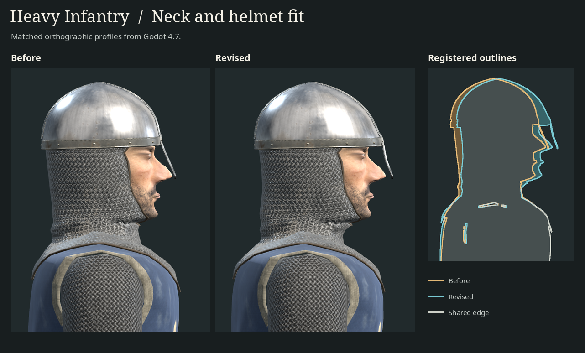
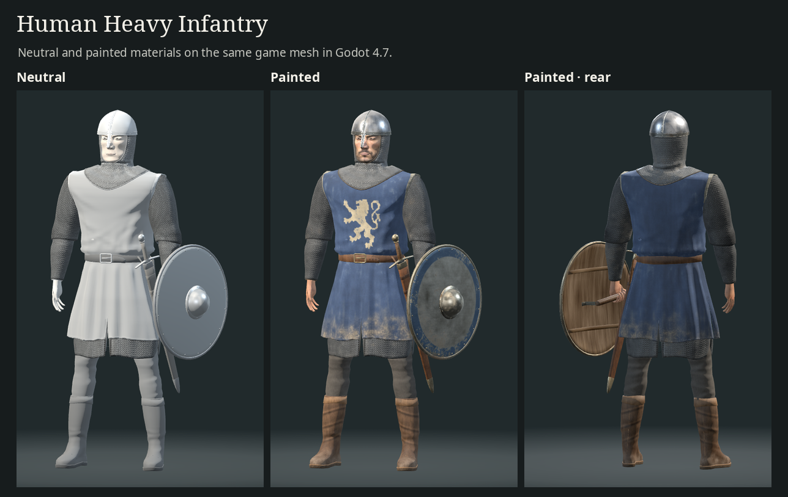
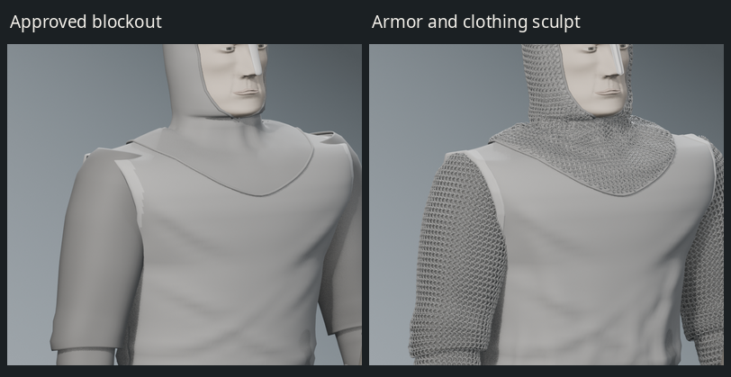
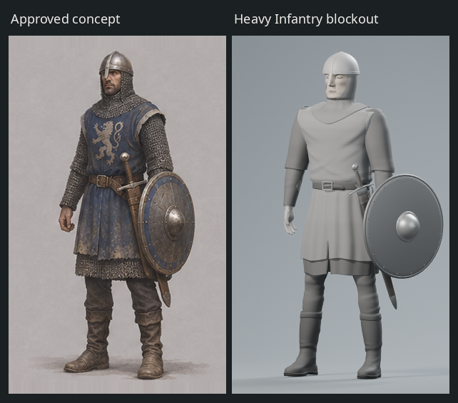

# Human Heavy Infantry

For a new unit, follow the [unit art workflow](../../../docs/unit-art-workflow.md). For Heavy Infantry, use the [high-resolution sculpt](../human_heavy_infantry.blend) to edit the armor construction and the [painted game mesh](../human_heavy_infantry_game.blend) to paint or pose the soldier in Blender 4.3 or later.

In the standing study, the helmeted soldier is 1.815 m tall and faces −Y. His planted boots span 0.574 m at their widest point, about 32% of his height. His left hand carries the round shield. The sword hangs sheathed at his left hip.

## Rig and motion review

The painted model has a dedicated Heavy Infantry rig. Open **Unit Test → Humans · Heavy Infantry** for the shield-ready idle, shield block, shield walk, combat run, and equipment fit tests. [Godot previews, Blender controls and formation measurements](rig.md)

## Standing posture

In the revised pose the neck leans 7° forward from vertical, measured between cross-section centers 98 mm apart in the underlying anatomy. The head sits 17 mm farther forward with the same eye line. The mail fits closer under the jaw and opens out over the upper back. The inner shoulder rises into the neck and tapers toward the shoulder cap. The helmet brow and nasal guard project forward of the face.

[Front, rear three-quarter and native 96-pixel comparisons](review/posture/fit.png)

## Painted Heavy Infantry

The faded blue surcoat carries the approved concept’s pale gold rampant lion. Chipped blue paint exposes the steel shield face, and the mail backing stays dark between links.

[Approved concept](reference/approved-concept.png) · [Face and equipment details](review/materials/details.png) · [96-pixel figures and 64-soldier formation](review/materials/formation.png)

Open [heavy_infantry_formation.tscn](../../../tests/heavy_infantry_formation.tscn) in Godot 4.7 and press **F6** to see two platoons of the painted Heavy Infantry. The 64-soldier formation used 386 draw calls in Godot 4.7 Compatibility, with 24,352 triangles and one shared material per soldier. For texture painting in Blender, open the [editable game mesh](../human_heavy_infantry_game.blend).

## Game mesh

Open the [game mesh and Godot comparison](game-mesh.md) for the paintable Blender model, runtime GLB, baked mail, and 64-unit review. The [approved high-resolution sculpt](../human_heavy_infantry.blend) remains the source for the bake.

## Armor and clothing sculpt

The coif gathers below the jaw, the mail sleeves bend at the elbows, and the surcoat draws into the girdle above the split skirt. The nasal guard joins the rolled brow band at two peened fasteners. The comparison stills and turntable use the approved blockout’s orthographic camera and studio lighting.

| Review | What to look for |
| --- | --- |
| [Before and after at full and skirmish size](review/sculpt/full-body.png) | Compare the weight of the sleeves, compression at the belt and the separate cloth and mail hems. |
| [Helmet and shoulder close-ups](review/sculpt/construction.png) | Follow the brow band through the nasal join and the mail hood down to the shoulder. |
| [Side-by-side turntable](review/sculpt/turntable.mp4) | Watch the same four-second rotation on both models. |

## Approved proportion study

| Review | What to look for |
| --- | --- |
| [Concept and clay](review/concept-and-clay.png) | Compare the face opening, shoulder width, belt, layered hems and boot spacing at the same standing height. |
| [Face and shield grip](review/details.png) | Inspect the nasal guard and cheek opening, then the fingers curled around the shield grip. The second view isolates the shield, left hand and lower sleeve. The small figures show the silhouette at 96 pixels tall. |
| [360° turntable](review/turntable.mp4) | Follow the shield dish, suspension, skirt vents and stance around the entire figure. |
| [Approved concept](reference/approved-concept.png) · [Proportion guide](reference/proportion-guide.png) | The six original views and a registered guide for crown, belt, hem and foot placement. |

In the right profile, more of the far edge of the shield shows behind the forearm than in the painting. The model uses the same rigid circular shield and grip position in every view.

## Editing the high-resolution sculpt

The anatomy, garments, headgear and equipment are grouped in the Outliner. The hood, sleeves and mail skirt each have editable rows of points that place the links. Their Geometry Nodes modifiers share one wire-ring shape. Toggle those objects in the Outliner to inspect the sculpted folds beneath the links. The anatomy collection includes a hidden body beneath the clothing. The head, hands, surcoat, armor, shield, sword and scabbard are independently editable. Materials are neutral clay for reviewing the forms.

Enable the **Modeling reference views** collection in the Outliner to use the six packed concept crops. Isolate the desired reference and switch to its orthographic view. The crops share a common scale and floor line.

Press **Space** in the timeline to play the four-second studio rotation. Frame 1 is the front view. Only the turntable parent is animated. The sculpt serves as the high-resolution source for the [rigged game mesh](rig.md). Godot’s source-directory ignore file keeps the review materials out of the game.
