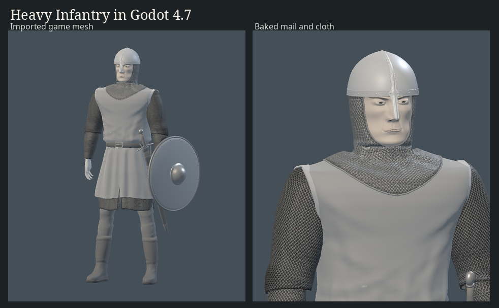

# Human Heavy Infantry game mesh

[Editable Blender game mesh](../human_heavy_infantry_game.blend) · [Godot GLB](../../models/human_heavy_infantry.glb) · [Approved mail sculpt](../human_heavy_infantry.blend)

The game mesh stands 1.815 m in the helmet and uses 24,352 triangles and one shared material. The editable Blender file retains the garment panels and shaping loops at the shoulders, elbows, knees and wrists for the Heavy Infantry rig. The Godot export batches these pieces into a body, a round shield, and a full sword with grip pivots for the two items. The scabbard stays on the body. The neutral plates show the original standing study. The [rigged model and motion review](rig.md) use the painted materials and approved posture.

## Neutral mesh review



| File | What to inspect |
| --- | --- |
| [Sculpt and game mesh](review/game-mesh/comparison.png) | Matched studio views and 96-pixel silhouettes. |
| [Mail and face close-ups](review/game-mesh/details.png) | The hood, sleeve and skirt use baked links while the nasal guard, shield rim and skirt splits carry their own geometry. |
| [Matched turntable](review/game-mesh/turntable.mp4) | Compare both versions through the same four-second rotation. |
| [UV layout and checker](review/game-mesh/uv-checker.png) | Inspect the face, chest panel and shield front before painting. |
| [64 Heavy Infantry in Godot](review/game-mesh/formation.png) | Two opposing formations with 32 copies of the runtime GLB apiece. |

The front silhouette overlaps the approved sculpt by 99.55% at 96 pixels tall. The three-quarter view overlaps by 99.48%. Both use the same orthographic camera, scale and pose.

## Painting and baking

The body and equipment use a single, unmirrored paint UV set. The facial surface, shield front, and central surcoat panel each have a continuous island. The central crest area has approximately 232 × 255 pixels at 2048 × 2048. The atlas has 879 islands with at least eight pixels between islands at that resolution. The UV overlap check found zero intersecting triangle interiors. The [current painted maps](../../models/heavy_infantry/) are also packed into the Blender game mesh. The [painted material review](README.md#painted-heavy-infantry) shows the same model with its painted materials.

| Texture | Use |
| --- | --- |
| `painted_base_color.png` | 2048 × 2048, sRGB. Skin, dyed cloth, heraldry, painted and exposed steel, and leather. The projected wire mask separates links from the backing. |
| `armor_normal.png` | 2048 × 2048, linear data. Tangent-space surface detail in OpenGL +Y convention. Import as normal data. |
| `painted_roughness_metallic.png` | 1024 × 1024, linear data. Green contains roughness and blue contains metallic. |

The normal bake projects each mail receiver against its corresponding sculpted shell and wire courses. The six regions cover the coif, both upper sleeves, both forearms and the skirt. Baking them separately keeps the nearby shield, cloth and other sleeves out of the projection. The high-detail sculpt contains the editable wire instances for rebaking. At battle distance the baked mail reads slightly finer and more evenly than the individual rings on the sculpt. The helmet, shield boss, nasal guard and rim keep their geometry as the camera turns.

## Godot formation check

Open [heavy_infantry_formation.tscn](../../../tests/heavy_infantry_formation.tscn) in Godot 4.7 and press **F6** to view the Heavy Infantry. For a timed comparison, run from the project root. On macOS the default editor executable is `/Applications/Godot.app/Contents/MacOS/Godot`.

```sh
godot --path . res://tests/heavy_infantry_formation.tscn -- regular
godot --path . res://tests/heavy_infantry_formation.tscn -- heavy
```

An optional second argument after the unit name writes a PNG of the measured viewport. The scene places 64 static instances on the same floor, with the same camera, one shadow-casting light and full-detail meshes. It records elapsed wall time between rendered frames at 1024 × 640 after 20 warm-up frames. Each run samples 60 frames. Draw calls include the floor and shadow pass. Geometry counts come from the imported Godot meshes.

| Asset | Triangles per soldier | Vertices per soldier | Surfaces / materials per soldier | Draw calls, 64 soldiers | Median frame | 95th percentile |
| --- | ---: | ---: | ---: | ---: | ---: | ---: |
| Regular Infantry | 36,232 | 22,091 | 4 / 2 | 514 | 889.5 ms | 1201.8 ms |
| Heavy Infantry | 24,352 | 19,031 | 3 / 1 | 386 | 410.6 ms | 515.6 ms |

The Heavy Infantry used 32.8% fewer triangles per soldier and 24.9% fewer draw calls for the formation. These measurements used the Godot 4.7 Compatibility renderer on a four-vCPU Linux container with Mesa llvmpipe software rendering. Frame times include the render loop for a static formation. Mac GPU performance and animated skirmish costs require separate measurements.
