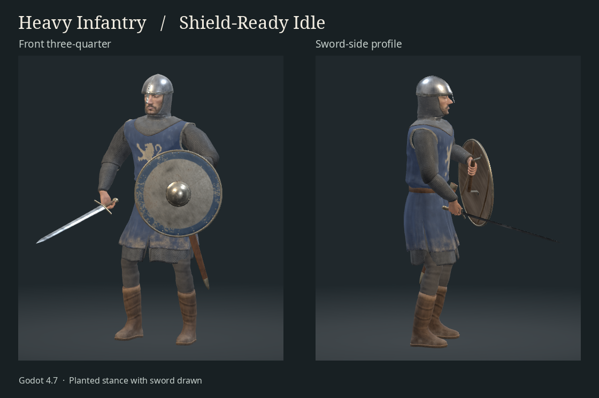
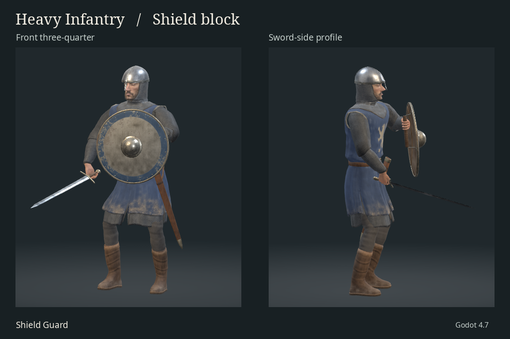
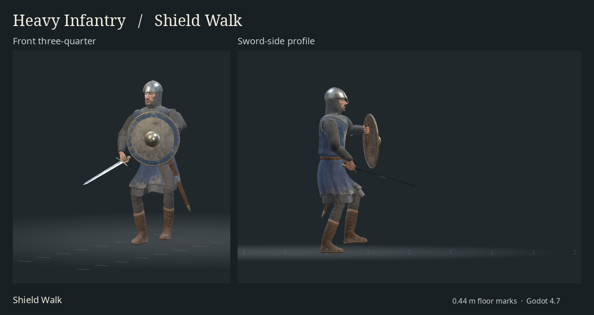
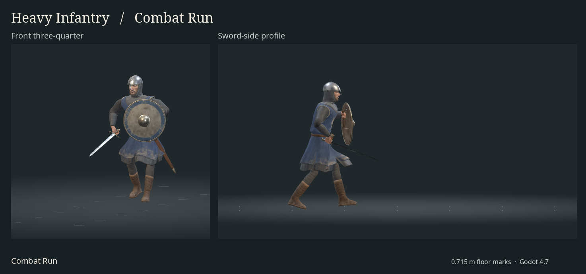
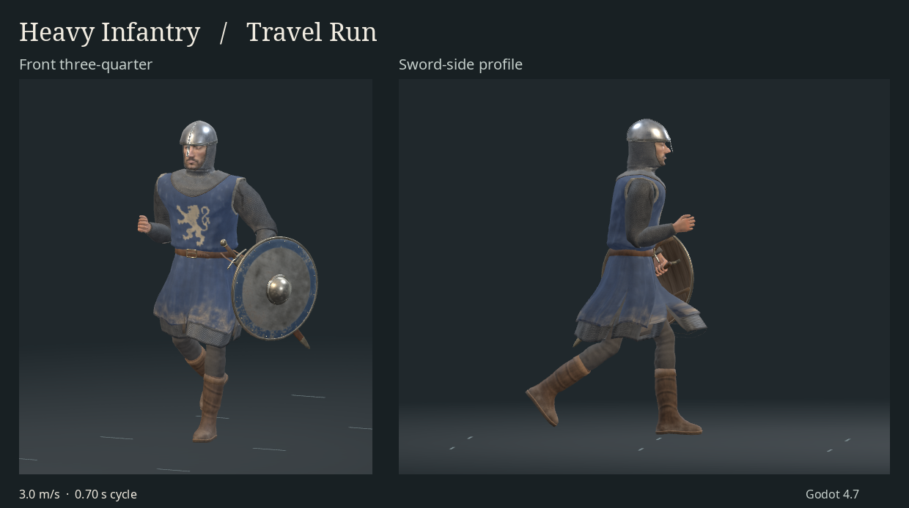
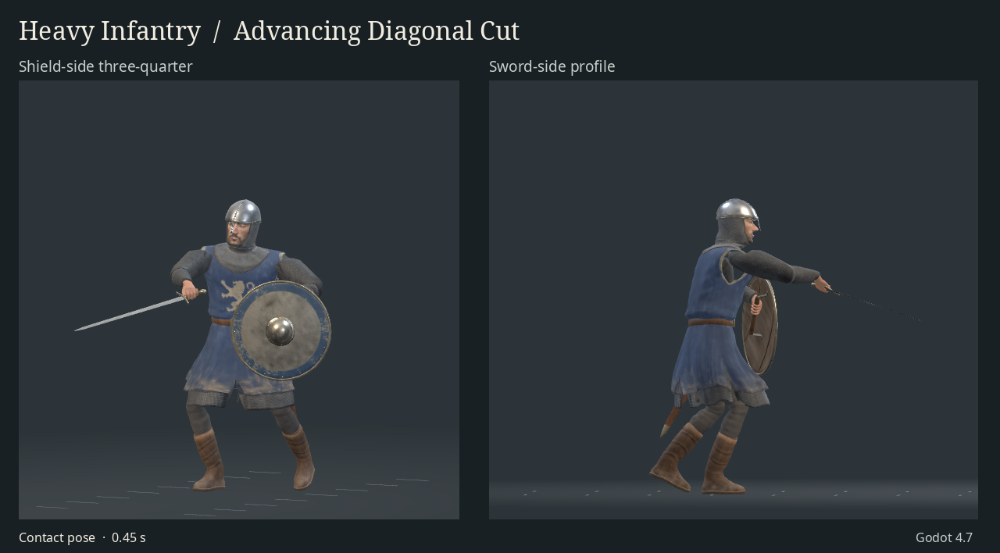

# Heavy Infantry rig

## Shield-Ready Idle



Open **Unit Test → Humans · Heavy Infantry** to play the 4.5-second idle. The sword stays low in the right hand, the shield sits forward below the eyes, and both boots stay planted. The soldier breathes in and shifts his weight subtly toward the shield side before settling back into the starting stance. [Two cycles from both angles, followed by a 64-soldier formation](review/idle/shield-ready-idle.mp4)

## Shield Block



Choose **Shield Raise**, **Shield Guard**, or **Shield Lower** under **Unit Test → Humans · Heavy Infantry**. The soldier shifts his weight onto the shield-side leg, protects his chest, and keeps his sword low throughout. The boots stay planted. [Full sequence from the front three-quarter and sword-side views](review/block/shield-block.mp4)

| Clip | Duration | Poses |
| --- | ---: | --- |
| **Shield Raise** | 0.43 s | Goes from the opening Shield-Ready Idle pose into full guard. |
| **Shield Guard** | 2.40 s per loop | Holds full guard with a small breath and shield adjustment. |
| **Shield Lower** | 0.60 s | Returns from full guard to the opening idle pose. |

## Shield Walk



Open **Unit Test → Humans · Heavy Infantry** and select **Shield Walk** for the looping gait. The soldier takes two short steps per cycle, keeps the shield in front of his chest, and carries the sword low. [Guard entry, two strides, return to guard, and a 64-soldier formation in Godot](review/walk/shield-walk.mp4)

| Clip | Duration | Motion |
| --- | ---: | --- |
| **Shield Walk Start** | 0.57 s | Loads the left boot, takes the first step with the right, and comes up to walking speed. The root advances 0.176 m. |
| **Shield Walk** | 1.10 s per loop | Walks in place. Match the loop to 0.8 m/s of forward travel for two 0.44 m steps. |
| **Shield Walk Stop** | 0.63 s | Slows over the right boot, brings the trailing foot forward, and returns to standing guard. The root advances 0.264 m. |

The start and stop match the opening pose of **Shield Guard** and the right-boot contact pose in **Shield Walk**. The runway in the video uses 0.44 m marks to show where each step lands.

## Combat Run



Choose **Run Start**, **Combat Run**, or **Run Stop** under **Unit Test → Humans · Heavy Infantry**. The soldier leans into the first step and tucks the shield, then plants a braking step before returning to guard. [Full start-to-stop sequence and 64-soldier formation in Godot](review/run/combat-run.mp4)

| Clip | Duration | Motion |
| --- | ---: | --- |
| **Run Start** | 0.45 s | Pushes off from Shield Guard and advances the root 0.429 m into the first right-boot contact. |
| **Combat Run** | 0.65 s per loop | Runs in place with a brief airborne phase between steps. At 2.2 m/s, each cycle covers 1.43 m in two 0.715 m steps. |
| **Run Stop** | 0.65 s | Brakes over the right boot, advances the root 0.286 m, and reunites both feet in Shield Guard. |

The run transitions meet the loop at its opening right-boot contact. The source actions use half-frame keys on the 30 fps Blender timeline, and the GLB bakes all three run clips at 60 fps.

## Travel Run



Select **Travel Run** under **Unit Test → Humans · Heavy Infantry**. The soldier leans forward, compresses over the planted boot, pushes off his toes, and folds the trailing knee before bringing it forward. He swings his relaxed right arm close to his ribs, with the shield carried at his left hip and the sword seated in its scabbard. [Front and side views in Godot](review/travel/travel-run.mp4)

The clip loops in place every **0.70 seconds**. At **3.0 m/s**, it covers **2.10 m per cycle**, averaging **1.05 m per step**. The preview shows forward motion at that speed against fixed ground marks. The editable action spans frames 1–22 at 30 fps, with half-frame keys baked at 60 fps for the GLB.

The gait is retargeted from a recorded straight jog, subject 35, trial 18. The data used in this project was obtained from mocap.cs.cmu.edu. The database was created with funding from NSF EIA-0196217. [Motion capture and reuse terms](https://github.com/una-dinosauria/cmu-mocap/blob/master/READMEFIRST.txt)

## Advancing Diagonal Cut



Select **Advancing Diagonal Cut** under **Unit Test → Humans · Heavy Infantry**. The soldier loads his left leg and raises the sword beside his helmet. As the right boot plants, the shoulder brings the arm forward and the elbow opens on one hinge. The forearm turns through the cut. The rear foot steps up as he returns to the opening Shield-Ready Idle pose. [Normal and quarter-speed playback in Godot](review/cut/advancing-diagonal-cut.mp4)

| Time | Pose |
| --- | --- |
| 0.00–0.14 s | Load the left leg and raise the sword. |
| 0.14–0.31 s | Push off, step forward, and plant the right boot. |
| 0.31–0.45 s | Lead with the hips, then turn the chest and bring the blade through the contact pose. |
| 0.45–0.60 s | Finish the diagonal below and in front of the shield. |
| 0.60–0.90 s | Bring the rear boot forward and settle back into the ready stance. |

The one-shot clip advances the root **0.36 m**. The contact pose is at **0.45 s**. The Blender action spans frames 1–28 at 30 fps. Godot imports the model at 120 fps. Run `godot --headless --script tests/heavy_infantry_cut.gd` to check the elbow hinge, drawn grip, and sheathed clips at and between imported keys.

## Equipment fit tests


[Shield fit motion from the front, side and at battle distance](review/rig/shield-fit.mp4) · [Editable Blender rig](../human_heavy_infantry_game.blend) · [Godot model](../../models/human_heavy_infantry.glb)

Open **Unit Test**, select **Humans · Heavy Infantry**, and choose **Shield Fit Test** or **Drawn Sword Fit**. The shield test shifts the soldier onto his left leg, raises the shield, holds the pose and returns to the approved standing pose in four seconds. The sword clip shows the separate right-hand grip pose. Pause the clip and use the Front, Side, Back view, or Face cameras to inspect the fit.

## Blender controls

Select **Heavy Infantry Rig** and enter Pose Mode. The **Hands, feet and joint targets** bone collection contains the hand and foot targets plus elbow and knee poles. The **Body controls** collection exposes the pelvis, spine, chest, clavicles, neck and head. The **Deform bones** collection exposes the weighted skeleton, including skirt panels and right-hand finger joints. Select a clip by name in the Action Editor. The shield-ready idle spans frames 1–136 at 30 fps. The shield raise, guard, and lower end on frames 14, 73, and 19. The shield walk start, loop, and stop end on frames 18, 34, and 20. The run start, loop, and stop end on frames 14.5, 20.5, and 20.5. The GLB uses Godot’s `-loop` suffix for the idle, guard, walk, and run.

The left-hand grip carries the shield as a rigid piece. The scabbard follows the pelvis, with its hangers weighted across the belt and scabbard. In Blender, **Sword in hand** seats the sword in the scabbard at 0 and in the right-hand socket at 1. The advancing cut keys the right upper arm and forearm directly. In Godot, drawn clips use a fixed sword transform under the right hand and share one closed grip. **Shield Fit Test** and **Travel Run** place the sword in the scabbard.

The coif blends from the head and neck into the chest and clavicles. The two visible mail sleeve pieces use the same bend weights at their overlap. Front and rear skirt bones on each side follow the thighs and move the surcoat, mail and lining together. The boot soles follow the feet, with ankle weights blended into the leather uppers.

## Formation check

The Godot export uses 44 bones, 24,352 triangles, three surfaces and one shared material. The shield fit, idle, block and walk clips bake the Blender control rig at 30 frames per second. The model's origin stays planted through the shield fit clip.

Run these commands from the project root in Godot 4.7. Each variant uses the same 64-unit camera, lighting and renderer settings. The animated variants stagger playback across the formation.

```sh
godot --path . res://tests/heavy_infantry_formation.tscn -- heavy
godot --path . res://tests/heavy_infantry_formation.tscn -- heavy-animated
godot --path . res://tests/heavy_infantry_formation.tscn -- heavy-idle
```

| 64 Heavy Infantry | Median draw calls | Median frame | 95th percentile |
| --- | ---: | ---: | ---: |
| At rest | 386 | 484.0 ms | 606.7 ms |
| Shield fit clip playing | 386 | 574.4 ms | 744.0 ms |

Both runs used Godot 4.7 Compatibility and Mesa llvmpipe software rendering on Linux at 1024 × 640. Each run sampled 60 frames after a 20-frame warm-up. The frame times describe this renderer and test scene. [Animated formation capture](review/rig/formation.png)
