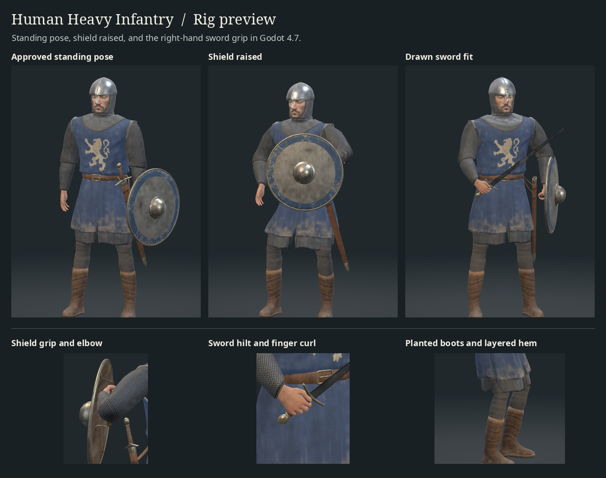

# Heavy Infantry rig



[Shield fit motion from the front, side and at battle distance](review/rig/shield-fit.mp4) · [Editable Blender rig](../human_heavy_infantry_game.blend) · [Godot model](../../models/human_heavy_infantry.glb)

Open **Unit Test**, select **Humans · Heavy Infantry**, and choose **Shield Fit Test** or **Drawn Sword Fit**. The shield test shifts the soldier onto his left leg, raises the shield, holds the pose and returns to the approved standing pose in four seconds. The sword clip shows the separate right-hand grip pose. Pause the clip and use the Front, Side, Back view, or Face cameras to inspect the fit.

## Blender controls

Select **Heavy Infantry Rig** and enter Pose Mode. The **Hands, feet and joint targets** bone collection contains the hand and foot targets plus elbow and knee poles. The **Body controls** collection exposes the pelvis, spine, chest, clavicles, neck and head. The **Deform bones** collection exposes the weighted skeleton, including skirt panels and right-hand finger joints. In the Action Editor, choose **Shield Fit Test** or **Drawn Sword Fit**.

The left-hand grip carries the shield as a rigid piece. The scabbard follows the pelvis, with its hangers weighted across the belt and scabbard. The rig's **Sword in hand** property seats the sword in the scabbard at 0 and in the right-hand socket at 1. **Drawn Sword Fit** also keys the right-hand finger curl.

The coif blends from the head and neck into the chest and clavicles. The two visible mail sleeve pieces use the same bend weights at their overlap. Front and rear skirt bones on each side follow the thighs and move the surcoat, mail and lining together. The boot soles follow the feet, with ankle weights blended into the leather uppers.

## Formation check

The Godot export uses 44 bones, 24,352 triangles, three surfaces and one shared material. The runtime clips bake the Blender control rig at 30 frames per second. The model's origin stays planted through the shield fit clip.

Run these commands from the project root in Godot 4.7. Both variants use the same 64-unit camera, lighting and renderer settings. The animated run staggers playback across the formation.

```sh
godot --path . res://tests/heavy_infantry_formation.tscn -- heavy
godot --path . res://tests/heavy_infantry_formation.tscn -- heavy-animated
```

| 64 Heavy Infantry | Median draw calls | Median frame | 95th percentile |
| --- | ---: | ---: | ---: |
| At rest | 386 | 484.0 ms | 606.7 ms |
| Shield fit clip playing | 386 | 574.4 ms | 744.0 ms |

Both runs used Godot 4.7 Compatibility and Mesa llvmpipe software rendering on Linux at 1024 × 640. Each run sampled 60 frames after a 20-frame warm-up. The frame times describe this renderer and test scene. [Animated formation capture](review/rig/formation.png)
